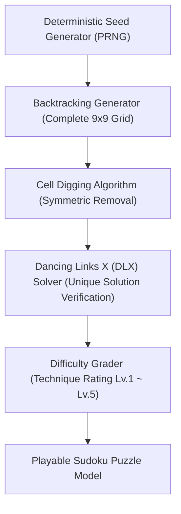
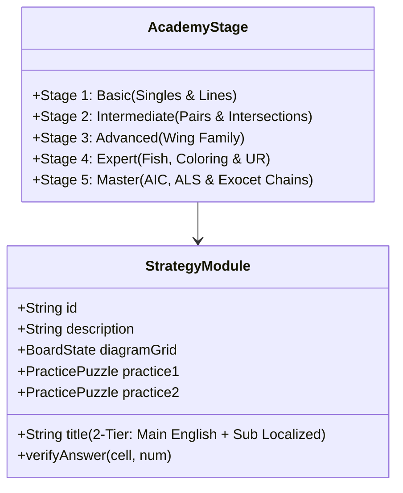

# [SUIDOKU_TECHNICAL_SPEC] 스도쿠(Suidoku) 애플리케이션 상세 기술 명세서

> **문서 버전**: 2.0.0 (Release v1.2.0 Architecture)  
> **상위 공통 명세서**: [`COMMON_APP_TECHNICAL_SPEC.md`](file:///D:/PowerNeJa/PythonWorkspace/Project_Dev/app_common/docs/COMMON_APP_TECHNICAL_SPEC.md) (전역 공통 표준 상속)  
> **타깃 런타임**: Android SDK 35 (Android 15), React 19, Vite 8, Capacitor 8  

---

## 🔗 1. 공통 아키텍처 상속 관계도 (Inheritance Matrix)

본 애플리케이션은 `Project_Dev` 공통 코어 아키텍처를 기반으로 구축되었으며, 아래와 같이 공통 기능을 상속받고 스도쿠 특화 서브시스템을 확장하여 운영합니다.

| 아키텍처 영역 | 공통 기술 명세 ([`COMMON_APP_TECHNICAL_SPEC.md`](file:///D:/PowerNeJa/PythonWorkspace/Project_Dev/app_common/docs/COMMON_APP_TECHNICAL_SPEC.md)) | 스도쿠 특화 구현 (Suidoku Customization) |
| :--- | :--- | :--- |
| **다국어 QA** | 1단계: Universal Core 8-Gate 검증 엔진 상속 | 2단계: `app_common/l10n_engine/profiles/suidoku.mjs` (아카데미 5단계, 3분할 탭 제약, 브랜드명 Sudoku 검증) |
| **보안 / 데이터** | Zero-PII 원칙, 무손실 클라우드 병합 프로토콜 | 스도쿠 판 상태(9x9 그리드, 메모 배열, 히스토리 스택), 365일 캘린더 출석 데이터 |
| **UI / 반응형** | 상하단 Safe Area, 1줄 고정 UI 글자수 제약 | 3D 클레이모피즘 키패드, 9x9 스도쿠 보드 충돌 감지 애니메이션, 5각 레이더 차트 |
| **수익화 / IAP** | AdMob 배너/전면/리워드 라이프사이클, 영구 광고 제거 | 세라믹 테마 맞춤형 광고 영역 채움, 힌트 충전 리워드(게임당 최대 2회), 지난 일차 언락 |
| **오디오 / 햅틱** | WebAudio Bridge, 브라우저 햅틱 표준 | 숫자 입력 시 타건음, 정답/오답 사운드 차별화, 실수 시 진동 피드백 |

---

## 🧩 2. 게임 코어 엔진 및 알고리즘 (Game Core & Solver Engine)

### 2.1 퍼즐 생성 및 난이도 산정 엔진
1. **결정론적 PRNG (Deterministic PRNG)**:
   * 데일리 챌린지 및 1:1 대전에서 전 세계 모든 유저가 동일한 날짜/시드에서 100% 동일한 퍼즐을 플레이하도록 보장 (`src/utils/prng.js`).
2. **유일해 검증 (DLX Solver)**:
   * 크누스(Donald Knuth)의 **Dancing Links Algorithm X (DLX)**를 구현하여, 빈칸을 제거할 때마다 해가 반드시 유일(Unique Solution = 1)함을 0.01ms 내에 검증 (`src/utils/sudokuSolver.js`).
3. **5단계 난이도 체계**:
   * **Lv.1 (Initiation / 초급)**: 단일 숫자 및 라인 소거법만으로 해결 가능 (빈칸 30~35개)
   * **Lv.2 (Easy / 쉬움)**: 숨은 싱글 및 기본 블록 교차 배제 필요 (빈칸 38~42개)
   * **Lv.3 (Medium / 보통)**: Naked/Hidden Pair, Triple 등 페어 기법 요구 (빈칸 45~48개)
   * **Lv.4 (Hard / 어려움)**: X-Wing, Y-Wing, 3D Medusa 등 고급 윙/컬러링 요구 (빈칸 50~54개)
   * **Lv.5 (Master / 마스터)**: Swordfish, Jellyfish, AIC, ALS, Exocet 등 마스터 체인 요구 (빈칸 55~58개)

---

## 🎓 3. 스도쿠 아카데미 32기법 5단계 시스템 (Sudoku Academy)

아카데미는 단순한 텍스트 가이드가 아닌 **인터랙티브 실전 훈련 엔진**으로 동작함 (`src/components/AcademyScreen.jsx`, `src/data/academy/`).

### 3.1 5단계 분류 체계 (`src/data/academy/`)
1. **Stage 1 (기초)**: Full House, Last Free Cell, Cross-Hatching, Naked Single, Hidden Single (5개)
2. **Stage 2 (중급)**: Pointing Pairs, Claiming, Naked/Hidden Pair, Naked/Hidden Triple, Naked/Hidden Quad (8개)
3. **Stage 3 (고급 - Wing Family)**: X-Wing, Y-Wing, XYZ-Wing, W-Wing, BUG, Remote Pairs (6개)
4. **Stage 4 (전문가 - Fish, Coloring & UR)**: Swordfish, Jellyfish, Unique Rectangles, Simple Colouring, 3D Medusa, XY-Chains, WXYZ-Wing, Empty Rectangles (8개)
5. **Stage 5 (마스터 - AIC, ALS & Exocet)**: Finned X-Wing, Alternating Inference Chains (AIC), Almost Locked Sets (ALS), Forcing Chains, Exocet (5개)

### 3.2 2계층 카드 타이틀 렌더링 아키텍처
* 전략 카드는 상단의 **공식 영문 기법명(굵은 15px)**과 하단의 **현지화 해설명(12.5px)**으로 2줄 분리 렌더링되어 다국어 UI 줄바꿈을 완벽 방어함.

---

## 🎮 4. 게임 모드 파이프라인 (Game Modes Engine)

1. **솔로 클래식 (Solo Classic)**: 전통적인 3-Mistake 하트 시스템 및 자동 에러 검출 토글 지원.
2. **타임어택 / 스피드런 (Speedrun)**:
   * 0초부터 카운트업 타이머 진행.
   * 연속 정답 시 `🔥 Combo Streak` (최대 배수 가산점) 부여.
   * 오답 입력 시 `+10초` 페널티 시간 즉시 가산.
3. **서바이벌 / 제한시간 모드 (Survival)**:
   * 난이도별 카운트다운 타이머 (Lv.1: 5분 ~ Lv.5: 15분).
   * 0초 도달 전 그리드를 완성해야 클리어되는 긴장감 넘치는 모드.
4. **데일리 챌린지 365 (Daily Challenge)**:
   * 1년 365일 날짜별 전용 시드 퍼즐.
   * 월별 마스터 뱃지 달성 프로그레스 (`15+ 완료 시 골드 뱃지`).
   * 지난 날짜(🔒)는 리워드 광고 시청 후 즉시 잠금 해제 플레이 가능.
5. **1:1 실시간 대전 & AI 봇 대전 (PvP & AI Battle)**:
   * 실시간 상대방 진행 상황(남은 칸 수) 인디케이터 동기화.
   * MMR 레이팅 시스템 및 경기 종료 후 복기/재대결(Rematch) 트리거.

---

## 🧠 5. 5대 인지능력 두뇌 IQ 분석 엔진 (Brain IQ Report)

플레이어의 누적 플레이 데이터를 기반으로 5대 인지능력을 실시간 계산하여 5각형 레이더 차트로 시각화 (`src/components/BrainReportScreen.jsx`).

$$IQ_{Score} = 100 + \sum_{i=1}^{5} \left( \frac{Score_i - \mu_i}{\sigma_i} \right) \times 10$$

### 5.1 5대 인지 축 지표
1. **집중력 (Focus / Concentration)**: 오답률이 극도로 낮고 연속 정답을 유지하는 능력.
2. **지속력 (Durability / Mental Stamina)**: 장시간/고난도(Lv.4~5) 퍼즐을 끝까지 포기하지 않고 해결하는 인내력.
3. **논리 추론력 (Logic Deduction)**: 힌트 없이 중급/고급 테크닉을 활용하여 해결한 비율.
4. **처리 속도 (Processing Speed)**: 난이도별 기준 클리어 타임 대비 단축률.
5. **정확도 (Accuracy)**: 0-Mistake 무결점 클리어 빈도.

### 5.2 글로벌 티어 시스템
* `👑 Grand Master` (상위 1% 이내)
* `🧠 Mensa Level` (상위 5% 이내)
* `⚡ Superior Mind` (상위 15% 이내)
* `💡 Above Average` (상위 35% 이내)
* `🎯 Balanced Mind` (상위 60% 이내)
* `🌱 Growing Mind` (훈련 및 발전 단계)

---

## 🎨 6. 테마 엔진 및 촉각 물리 디자인 (Theme & Tactile Physics)

CSS 변수 시스템과 3D 클레이모피즘(Claymorphism)을 결합하여 4가지 감성 테마 제공 (`src/styles/themes.css`).

1. **Clay & Ceramic (Céramique & Argile)**: 따뜻한 흙과 도자기 질감, 오렌지/클레이 악센트.
2. **Matte Dark (Résine Sombre)**: 깊은 네이비 다크(`bg: #0F172A`)와 은은한 밤하늘 형광 포인트.
3. **Pure Ceramic (Claymorphism Pur)**: 화이트/아이보리 쿠션감의 3D 둥근 키패드.
4. **Editorial Newspaper (Papier Journal)**: 스위스 스타일의 정갈한 활자 및 신문 페이퍼 톤.
