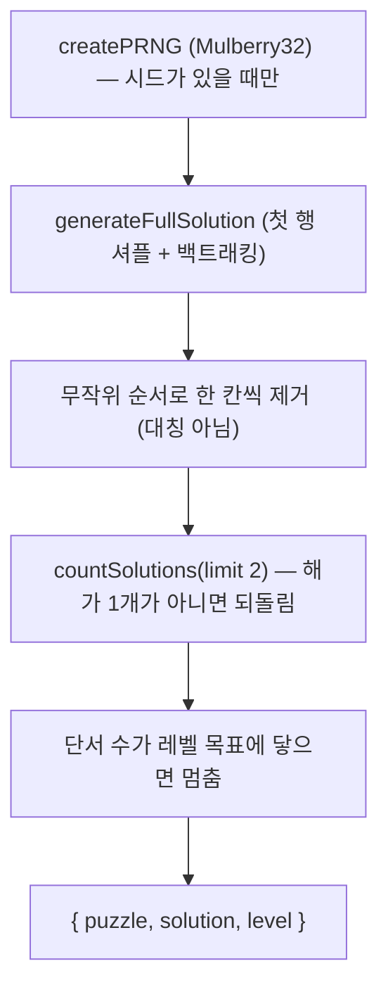
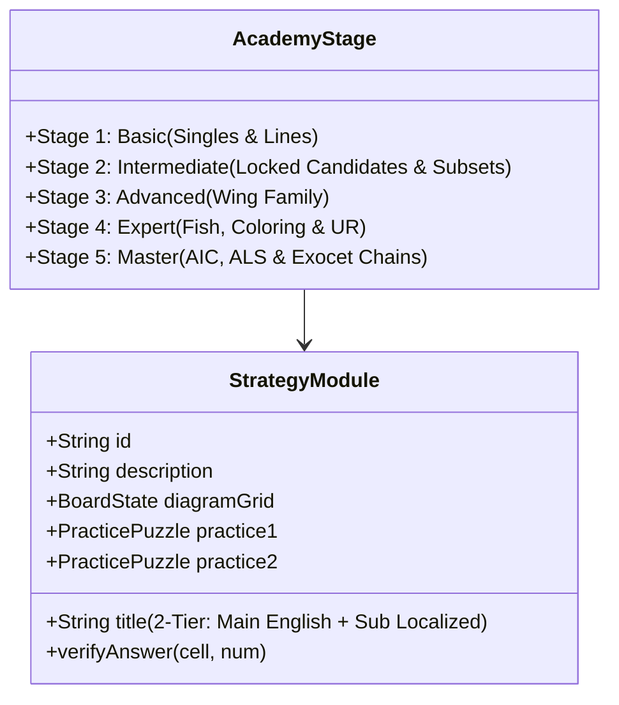

# [SUIDOKU_TECHNICAL_SPEC] 스도쿠(Suidoku) 애플리케이션 상세 기술 명세서

> **문서 버전**: 2.1.0 (2026-09-30, 1.3.2 코드와 대조 — §2·§4·§5 정정)  
> **상위 공통 명세서**: [`COMMON_APP_TECHNICAL_SPEC.md`](../../../app_common/docs/COMMON_APP_TECHNICAL_SPEC.md) (전역 공통 표준 상속)  
> **타깃 런타임**: Android SDK 35 (Android 15), React 19, Vite 8, Capacitor 8  
> **⚠️ 빠진 것 (2026-10-16 확인)**: 킬러 스도쿠(2026-10-01~)는 이 명세에 없다 — 생성·풀이·묶음 그리기·난이도·기록·모드·대전 전부.
> 코드는 `src/engine/killer/`(`killerGenerator.js`·`killerSolver.js`·`cageLayout.js`·`killerTimes.js`)·`src/engine/variants.js`, 경위는 Diary 91 이후. 아래 §3 의 아카데미 숫자만 2026-10-16 에 맞췄다.  

---

## 🔗 1. 공통 아키텍처 상속 관계도 (Inheritance Matrix)

본 애플리케이션은 `app_common` 공통 코어 아키텍처를 기반으로 구축되었으며, 아래와 같이 공통 기능을 상속받고 스도쿠 특화 서브시스템을 확장하여 운영합니다.

| 아키텍처 영역 | 공통 기술 명세 ([`COMMON_APP_TECHNICAL_SPEC.md`](../../../app_common/docs/COMMON_APP_TECHNICAL_SPEC.md)) | 스도쿠 특화 구현 (Suidoku Customization) |
| :--- | :--- | :--- |
| **다국어 QA** | 1단계: Universal Core 8-Gate 검증 엔진 상속 | 2단계: `app_common/l10n_engine/profiles/suidoku.mjs` (아카데미 5단계, 3분할 탭 제약, 브랜드명 Sudoku 검증) |
| **보안 / 데이터** | 개인정보 최소 처리 — 이름·이메일을 직접 받지 않는다. 광고 ID(AdMob)·Firebase 익명 ID·Play Games 계정은 처리하며 `docs/privacy.html` 에 적혀 있다 ("Zero-PII" 표현은 2026-09-30 감사 D03 으로 뺐다). 저장은 평문 JSON localStorage, 앱 수준 암호화 없음. 무손실 클라우드 병합 (`progressMerge.js`) | 스도쿠 판 상태(9x9 그리드, 메모 배열, 히스토리 스택), 365일 캘린더 출석 데이터 |
| **UI / 반응형** | 상하단 Safe Area, 1줄 고정 UI 글자수 제약 | 3D 클레이모피즘 키패드, 9x9 스도쿠 보드 충돌 감지 애니메이션, 5각 레이더 차트 |
| **수익화 / IAP** | AdMob 배너/전면/리워드 라이프사이클, 영구 광고 제거 | 세라믹 테마 맞춤형 광고 영역 채움, 힌트 충전 리워드(게임당 최대 2회), 지난 일차 언락 |
| **오디오 / 햅틱** | WebAudio Bridge, 브라우저 햅틱 표준 | 숫자 입력 시 타건음, 정답/오답 사운드 차별화, 실수 시 진동 피드백 |

---

## 🧩 2. 게임 코어 엔진 및 알고리즘 (Game Core & Solver Engine)

> **2026-09-30 정정 (외부 감사 D01).** 이 절은 대칭 제거·DLX·기법 난이도 판정·"0.01ms 검증"을
> 구현 사실로 적고 있었다. 전부 구현된 적이 없다. 아래는 `src/engine/SudokuEngine.js` 를 읽고 다시 쓴 것이고,
> 원하던 설계는 맨 아래 「미구현」에 따로 남겼다. 동작하는 백트래킹 솔버를 명세에 맞추려고 바꿀 이유는 없다.

### 2.1 퍼즐 생성과 난이도 — 실제 구현 (`src/engine/SudokuEngine.js`)
1. **PRNG**: `createPRNG(seed)` — Mulberry32. 시드가 있을 때만 쓴다. **데일리 챌린지**는 날짜 키를 시드로 넘겨
   (`dailyChallenge.js` → `generatePuzzle(level, dateKey)`) 같은 날 같은 퍼즐이 된다. **1:1 대전은 시드를 쓰지 않는다** —
   방을 만든 쪽이 `generatePuzzle(level)` 로 만든 판과 해답을 `match_created` 에 실어 보내고, 상대는 그것을 받는다.
2. **솔버**: `solveSudoku` / `countSolutions` — MRV(후보가 가장 적은 칸 먼저) 백트래킹. DLX 아님.
   `countSolutions(grid, 2)` 는 해를 2개까지만 센다. 측정한 속도 수치는 없다.
3. **제거**: 81칸을 섞은 순서대로 하나씩 비우고, 해가 1개가 아니게 되면 그 칸을 되돌린다. 대칭 제거가 아니다.
   되돌림이 많으면 목표 단서 수에 못 미친 채(단서가 더 많은 채) 끝날 수 있다.
4. **난이도 = 단서 수**. 기법 판정은 없다. 어떤 레벨도 특정 기법을 "반드시 요구"한다고 보장하지 않는다.

| 레벨 | 목표 단서 수 | 빈칸 | 제한시간 모드 시간 |
| :--- | :---: | :---: | :---: |
| Lv.1 | 50 | 31 | 4분 |
| Lv.2 | 42 | 39 | 6분 |
| Lv.3 | 34 | 47 | 8분 |
| Lv.4 | 28 | 53 | 12분 |
| Lv.5 | 24 | 57 | 18분 |

(`DIFFICULTY_CONFIG` 가 정본이다. 이 표와 다르면 코드가 맞다.)

### 2.2 미구현 — 원하던 설계 (구현 사실 아님)
* DLX(Algorithm X) 솔버
* 기법 기반 난이도 판정(어떤 기법이 필요한지로 레벨을 매김)
* 대칭 단서 제거

---

## 🎓 3. 스도쿠 아카데미 40기법 6탭 시스템 (Sudoku Academy)

아카데미는 단순한 텍스트 가이드가 아닌 **인터랙티브 실전 훈련 엔진**으로 동작함 (`src/components/AcademyScreen.jsx`, `src/data/academy/`).

### 3.1 5단계 분류 체계 (`src/data/academy/stage1~5.js`, 2026-09-30 대조)
1. **Stage 1 (기초)**: Full House, Last Free Cell, Cross-Hatching, Naked Single, Hidden Single (5개)
2. **Stage 2 (중급)**: Locked Candidates 1 (Pointing), Locked Candidates 2 (Claiming), Naked/Hidden Pair, Naked/Hidden Triple, Naked/Hidden Quad (8개)
3. **Stage 3 (고급 - Wing Family)**: X-Wing, XY-Wing / Y-Wing, XYZ-Wing, W-Wing, Bivalue Universal Grave (BUG), Remote Pairs (6개)
4. **Stage 4 (전문가 - Fish, Coloring & UR)**: Swordfish, Jellyfish, Unique Rectangles, Simple Coloring, 3D Medusa, XY-Chains, WXYZ-Wing, Empty Rectangles (8개)
5. **Stage 5 (마스터 - AIC, ALS & Exocet)**: Finned X-Wing / Swordfish, Alternating Inference Chains (AIC), Almost Locked Sets (ALS), Forcing Chains, Exocet (5개)
6. **킬러 탭** (`src/data/academy/stageKiller.js`, 2026-10-15): 묶음의 마지막 칸, 조합이 하나뿐인 묶음, 두 칸 묶음의 합, 45 규칙, 꼭 들어가는 숫자, 여러 칸의 45 규칙(숨은 묶음), 들어감·나감 차이, 묶음 쪼개기 (8개).
   연습판은 킬러 9×9 판(묶음 그림 포함) — `scripts/academy/killer/write_killer.mjs` 가 `src/data/academy/practice/killerPractice.js` 를 만든다(손으로 고치지 않는다).

연습은 기법마다 2개, 모두 80개 — 게이트 2-5(수학)·3-11(13개 언어 실제 풀이).

### 3.2 2계층 카드 타이틀 렌더링 아키텍처
* 전략 카드는 상단의 **공식 영문 기법명(굵은 15px)**과 하단의 **현지화 해설명(12.5px)**으로 2줄 분리 렌더링되어 다국어 UI 줄바꿈을 완벽 방어함.

---

## 🎮 4. 게임 모드 파이프라인 (Game Modes Engine)

1. **솔로 클래식 (Solo Classic)**: 전통적인 3-Mistake 하트 시스템 및 자동 에러 검출 토글 지원.
2. **타임어택 / 스피드런 (Speedrun)**:
   * 0초부터 카운트업 타이머 진행.
   * 3.5초 안에 연속 정답이면 콤보 (`useGameTimer.js`).
   * 오답 입력 시 `+10초` 페널티 시간 즉시 가산.
3. **서바이벌 / 제한시간 모드 (Survival)**:
   * 난이도별 카운트다운 타이머 — 4 / 6 / 8 / 12 / 18분 (위 2.1 표, `DIFFICULTY_CONFIG.timeLimitSeconds`).
   * 0초 도달 전 그리드를 완성해야 클리어.
4. **데일리 챌린지 365 (Daily Challenge)**:
   * 날짜 키를 시드로 한 날짜별 퍼즐.
   * 월별 배지: 한 달에 15회 이상 완료 (`getMonthlyBadgeProgress`).
   * 지난 날짜(🔒)는 리워드 광고 시청 후 잠금 해제 플레이 가능.
5. **1:1 실시간 대전 & AI 봇 대전 (PvP & AI Battle)**:
   * 실시간 상대방 진행 상황(남은 칸 수) 인디케이터 동기화.
   * 대전 레이팅(`battleRating.js`) 및 경기 종료 후 재대결(Rematch). 대전은 솔로 승률에 들어가지 않는다 (1.3.2).

---

## 🧠 5. 로직 스코어와 5축 프로필 (Logic Score · Brain Report)

> **2026-09-30 정정 (외부 감사 D01·D02).** 이 절은 "5축 표준점수 합산" 수식과 「Mensa Level」 등
> 전체 플레이어 대비 등급을 적고 있었다. 코드는 그렇게 계산하지 않고, 화면은 1.2.6 부터 백분위·멘사를
> 말하지 않는다 (SudokuDiary 「상위 % · 멘사 표기」). 아래가 `src/services/iqStatsService.js` 의 실제 산식이다.
> 코드 안의 이름(`calculateBrainIQ`)은 옛 이름이고, 화면 이름은 **Logic Score** 다.

### 5.1 Logic Score (`calculateBrainIQ`, 95~150)
승리가 0이면 100. 그 외에는 100 에서 시작해 셋을 더한다.
1. **양**: `min(6, log2(승리+1) × 1.5)`
2. **힌트 없이 깬 최고 레벨**: Lv.1~5 에 1 / 3 / 8 / 16 / 26
3. **승률**: `승률 × 5 × min(1, 판수/5)` (5판 미만이면 비례해서 덜 반영)

결과를 반올림해 95~150 으로 자른다. **실제 플레이어 분포를 읽지 않는다.** 등급(`tiers.*`) 경계는 이 점수를
평균 100·표준편차 15 정규분포에 넣은 꼬리값으로 정하지만, 그 수치는 화면에 "상위 X%" 로 나오지 않는다 —
실제 순위가 아니기 때문이다.

### 5.2 5축 프로필 (`calculateCognitiveProfile`, 각 15~99)
| 축 | 무엇으로 |
| :--- | :--- |
| speed | 레벨별 기준 시간(4/6/8/12/18분) 대비 최고 기록 |
| logic | 힌트 없이 깬 최고 레벨과 사다리를 얼마나 덮었는지 |
| accuracy | 시작한 판 대비 승률 (대전 제외) |
| endurance | 제한시간 모드 승리, 전체 판수로 보정 |
| focus | 무실수 승리 비율 + 최고 콤보 |

### 5.3 등급 (`tiers.*`)
`grandMaster` · `expert` · `superior` · `aboveAverage` · `developing` — 경계는 위 정규분포 꼬리 1% / 5% / 20% / 50%.
이름은 게임 안 등급일 뿐 지능 평가가 아니다. (옛 「Mensa Level」 은 1.2.6 에서 `expert` 로 바뀌었다.)

---

## 🎨 6. 테마 엔진 및 촉각 물리 디자인 (Theme & Tactile Physics)

CSS 변수 시스템과 3D 클레이모피즘(Claymorphism)을 결합하여 4가지 감성 테마 제공 (`src/styles/themes.css`).

1. **Clay & Ceramic (Céramique & Argile)**: 따뜻한 흙과 도자기 질감, 오렌지/클레이 악센트.
2. **Matte Dark (Résine Sombre)**: 깊은 네이비 다크(`bg: #0F172A`)와 은은한 밤하늘 형광 포인트.
3. **Pure Ceramic (Claymorphism Pur)**: 화이트/아이보리 쿠션감의 3D 둥근 키패드.
4. **Editorial Newspaper (Papier Journal)**: 스위스 스타일의 정갈한 활자 및 신문 페이퍼 톤.
